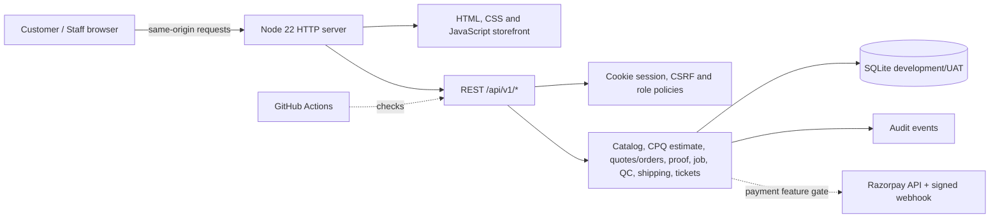
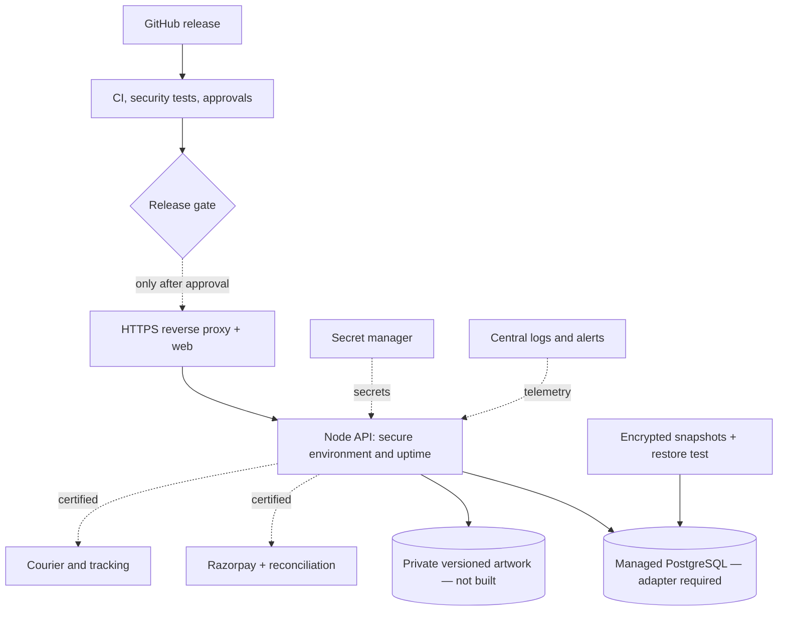

# DesignPro — architecture, deployment, ER, schema and maintenance/KT handover
**Snapshot:** 2026-11-10, repository source. This is a reverse-engineered code reference, **not** verification of a live cloud environment.

## Actual current application architecture

This repository does **not** contain a working NestJS/Next.js/Expo app or PostgreSQL adapter. Reused `app-skeleton` authorization/workflow/refund/signature helpers live under `packages/skeleton`; importing them is not equivalent to a completed production adapter.

## Current local deployment
`npm run db:migrate`, `npm run admin:bootstrap`, `npm run dev`; the Node server serves web and API on port 8787 by default. Database: `DATABASE_FILE`, default `./var/designpro.sqlite`. `GET /api/v1/health` exposes service status and whether test-only or payment flags are active. No deployed cloud provider, production domain, backup or service owner is confirmed by source.

## Proposed production deployment — target only

A separate static frontend origin requires an explicit cookie, CSRF and CORS redesign or a same-origin proxy. Do not deploy SQLite on ephemeral free hosting.

## Full source-schema ER (19 tables)

```mermaid
erDiagram
 USERS ||--o{ SESSIONS : signs_in
 USERS ||--o{ QUOTES : requests
 QUOTES ||--o| ORDERS : converts_to
 USERS ||--o{ ORDERS : places
 ORDERS ||--o{ PROOFS : revises
 ORDERS ||--o{ ORDER_DESTINATIONS : allocates
 ORDERS ||--o{ PAYMENTS : records
 ORDERS ||--o{ REFUNDS : requests
 PAYMENTS ||--o{ REFUNDS : funds
 ORDERS ||--o{ WORK_ORDERS : manufactures
 ORDERS ||--o{ QC_INSPECTIONS : checks
 USERS ||--o{ QC_INSPECTIONS : performs
 ORDERS ||--o{ SHIPMENTS : dispatches
 ORDER_DESTINATIONS ||--o{ SHIPMENTS : receives
 SHIPMENTS ||--o{ SHIPMENT_EVENTS : tracks
 ORDERS ||--o{ TICKETS : supports
 USERS ||--o{ TICKETS : opens
 TICKETS ||--o{ TICKET_MESSAGES : contains
 USERS ||--o{ TICKET_MESSAGES : writes
 USERS { TEXT id PK TEXT email UK TEXT role TEXT status }
 QUOTES { TEXT id PK TEXT user_id FK TEXT configuration TEXT estimate }
 ORDERS { TEXT id PK TEXT quote_id FK TEXT user_id FK INTEGER total_minor }
 PROOFS { TEXT id PK TEXT order_id FK INTEGER version TEXT status }
 ORDER_DESTINATIONS { TEXT id PK TEXT order_id FK INTEGER quantity }
 PAYMENTS { TEXT id PK TEXT order_id FK INTEGER amount_minor TEXT status }
 REFUNDS { TEXT id PK TEXT payment_id FK INTEGER refund_minor TEXT status }
 SHIPMENTS { TEXT id PK TEXT order_id FK TEXT destination_id FK INTEGER quantity }
 SHIPMENT_EVENTS { TEXT id PK TEXT shipment_id FK TEXT status }
 WORK_ORDERS { TEXT id PK TEXT order_id FK INTEGER quantity }
 QC_INSPECTIONS { TEXT id PK TEXT order_id FK TEXT actor_id FK TEXT result }
 TICKETS { TEXT id PK TEXT order_id FK TEXT created_by FK TEXT status }
 TICKET_MESSAGES { TEXT id PK TEXT ticket_id FK TEXT author_id FK }
 SESSIONS { TEXT token_hash PK TEXT user_id FK }
```

**Standalone entities:** `custom_roles`, `inventory`, `audit_events`, `webhooks`, `settings`. `orders.proof_id` in SQLite is a text pointer rather than declared FK; the proof relation is from `proofs.order_id`. Full column types and indexes: `docs/architecture-kt/SCHEMA_INDEX.md`. Current `migrate(db)` adds `shipments.destination_id` and `quantity` for existing UAT DBs.

## Data security / lifecycle
- Monetary values in INTEGER paise; quotes carry JSON-text configuration and estimate. Production needs immutable pricing/invoice snapshots, audited rounding and real tax decisions.
- `auth.mjs`: scrypt password hashes, hashed cookie sessions, CSRF and RBAC. Production needs verified identity, MFA, distributed rate-limiting, session revocation and org isolation.
- `audit_events` holds actor/entity/timestamp; never log customer artwork, credentials, tokens, PAN or payment data.
- `webhooks` stores provider event hash and ID to help reject replay; real provider settlement and reconciliation remain gated.
- Artwork preview is browser-local concept imagery only, not private uploaded production artwork.

## Local scripts, migration and diagnostics
```bash
cp .env.example .env
# Set BOOTSTRAP_EMAIL and a strong BOOTSTRAP_PASSWORD
npm run db:migrate
npm run admin:bootstrap
npm run schema:preflight
npm test
npm run coverage
npm run dev
# optional: python tests/visual-smoke.py
```
`schema:preflight` uses an **in-memory** SQLite instance; it is not a live DB test. The guarded `docs/architecture-kt/migrate-safe.sh` supports read-only planning and local existing-DB schema export, and requires backup reference, release SHA and reviewed command for apply. The PostgreSQL SQL candidate is not wired to the application. See migration strategy document.

## Maintenance and incident runbook
| Symptom | Inspect | Safe response |
|---|---|---|
| Catalog/quotes unavailable | /health, catalog, API console and request ID | Fix API; never invent prices |
| 401 login loop | Cookie origin/SameSite/Secure, session expiry and CSRF | Reauthenticate; don't disable auth |
| 403 | Role grant, resource owner, CSRF | Escalate access decision; never bypass |
| 409 order/proof | Actual order state, latest proof, job/QC requirements | Follow transition workflow |
| 429 login | Source IP and recent attempts | Preserve abuse evidence, distributed limiter for production |
| 500 | Sanitized request reference, DB disk/integrity and logs | Restore service or approved rollback |
| Payment mismatch | Provider transaction state, webhook and settlement IDs | Finance reconciliation; don't mark captured from redirects |
| DB failure | Verified encrypted backup, restore playbook and FK/integrity | Restore to isolation first, validate monetary records |

A release needs the exact host/region, TLS/domain owner, secrets vault, alerts, back-up/RPO/RTO, restore evidence, incident owner and roll-forward/cutback signoff. Source does not provide these values: do not fabricate them.

## 60-minute KT demo guide
| Time | Operator demonstration |
|---|---|
| 00–10 | BRD scope, code/deploy architecture, UAT limitations |
| 10–20 | Authentication, customer/staff roles, API/errors, schema & migrations |
| 20–32 | Configure product → indicative quote → staff firm price → acceptance |
| 32–45 | **Simulated** advance → latest proof approval → job card → QC → split delivery |
| 45–53 | Care tickets, refund approval, audit log and negative tests |
| 53–60 | CI/coverage, backup/restore, incidents, open defects, release signoff |

**KT acceptance:** A new maintainer can start the app and explain data models and restrictions; demonstrate rejected unauthorized customer read and skipped production stage; locate a safe error reference; run tests and schema preflight; and explain which external systems require approved integration.

**Handover evidence:** Git SHA, environment map, role matrix, API and schema inventory, migration history, local/staging CI and screenshots, UAT defect list, secret ownership (no secret values), RTO/RPO, customer acceptance and go/no-go decision.
