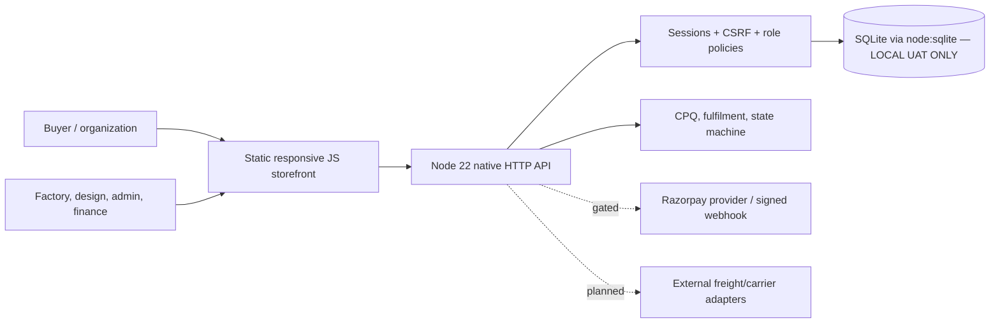

# DesignPro 0.3 — reverse-engineered HTTP, data, manufacturing and deployment map

> From [`varadatechworks/design-pro` `main`](https://github.com/varadatechworks/design-pro/tree/main), inspected 10 November 2026. **Source inventory / UAT only. Production readiness is blocked in docs/RELEASE_GATES.md.**

## Architecture

The database resides in an experimental Node SQLite file and is **not** a production-ready ephemeral hosting solution. The diagram is a logical app view, not deployed topology.

## Actual API URI tokens observed in `apps/api/server.mjs`
**26 distinct source literals**, including some prefix matching/dynamic subroutes. **Method, actor role, body schema and security guard must be confirmed in the exact handler** rather than inferred from the URI alone.

- `/api/v1/admin/audit` ([handler source](https://github.com/varadatechworks/design-pro/blob/main/apps/api/server.mjs))
- `/api/v1/admin/dashboard` ([handler source](https://github.com/varadatechworks/design-pro/blob/main/apps/api/server.mjs))
- `/api/v1/admin/inventory` ([handler source](https://github.com/varadatechworks/design-pro/blob/main/apps/api/server.mjs))
- `/api/v1/admin/quality-inspections` ([handler source](https://github.com/varadatechworks/design-pro/blob/main/apps/api/server.mjs))
- `/api/v1/admin/roles` ([handler source](https://github.com/varadatechworks/design-pro/blob/main/apps/api/server.mjs))
- `/api/v1/admin/uat/capture-payment` ([handler source](https://github.com/varadatechworks/design-pro/blob/main/apps/api/server.mjs))
- `/api/v1/admin/uat/settle-refund` ([handler source](https://github.com/varadatechworks/design-pro/blob/main/apps/api/server.mjs))
- `/api/v1/admin/users` ([handler source](https://github.com/varadatechworks/design-pro/blob/main/apps/api/server.mjs))
- `/api/v1/admin/work-orders` ([handler source](https://github.com/varadatechworks/design-pro/blob/main/apps/api/server.mjs))
- `/api/v1/auth/csrf` ([handler source](https://github.com/varadatechworks/design-pro/blob/main/apps/api/server.mjs))
- `/api/v1/auth/login` ([handler source](https://github.com/varadatechworks/design-pro/blob/main/apps/api/server.mjs))
- `/api/v1/auth/logout` ([handler source](https://github.com/varadatechworks/design-pro/blob/main/apps/api/server.mjs))
- `/api/v1/auth/me` ([handler source](https://github.com/varadatechworks/design-pro/blob/main/apps/api/server.mjs))
- `/api/v1/auth/register` ([handler source](https://github.com/varadatechworks/design-pro/blob/main/apps/api/server.mjs))
- `/api/v1/catalog` ([handler source](https://github.com/varadatechworks/design-pro/blob/main/apps/api/server.mjs))
- `/api/v1/estimate` ([handler source](https://github.com/varadatechworks/design-pro/blob/main/apps/api/server.mjs))
- `/api/v1/health` ([handler source](https://github.com/varadatechworks/design-pro/blob/main/apps/api/server.mjs))
- `/api/v1/orders` ([handler source](https://github.com/varadatechworks/design-pro/blob/main/apps/api/server.mjs))
- `/api/v1/payments/confirm` ([handler source](https://github.com/varadatechworks/design-pro/blob/main/apps/api/server.mjs))
- `/api/v1/payments/initiate` ([handler source](https://github.com/varadatechworks/design-pro/blob/main/apps/api/server.mjs))
- `/api/v1/payments/webhook` ([handler source](https://github.com/varadatechworks/design-pro/blob/main/apps/api/server.mjs))
- `/api/v1/proofs` ([handler source](https://github.com/varadatechworks/design-pro/blob/main/apps/api/server.mjs))
- `/api/v1/quotes` ([handler source](https://github.com/varadatechworks/design-pro/blob/main/apps/api/server.mjs))
- `/api/v1/refunds` ([handler source](https://github.com/varadatechworks/design-pro/blob/main/apps/api/server.mjs))
- `/api/v1/shipments` ([handler source](https://github.com/varadatechworks/design-pro/blob/main/apps/api/server.mjs))
- `/api/v1/tickets` ([handler source](https://github.com/varadatechworks/design-pro/blob/main/apps/api/server.mjs))

## Runtime and domain modules
- [`.github/workflows/quality.yml`](https://github.com/varadatechworks/design-pro/blob/main/.github/workflows/quality.yml)
- [`apps/api/auth.mjs`](https://github.com/varadatechworks/design-pro/blob/main/apps/api/auth.mjs)
- [`apps/api/bootstrap.mjs`](https://github.com/varadatechworks/design-pro/blob/main/apps/api/bootstrap.mjs)
- [`apps/api/db.mjs`](https://github.com/varadatechworks/design-pro/blob/main/apps/api/db.mjs)
- [`apps/api/migrate.mjs`](https://github.com/varadatechworks/design-pro/blob/main/apps/api/migrate.mjs)
- [`apps/api/server.mjs`](https://github.com/varadatechworks/design-pro/blob/main/apps/api/server.mjs)
- [`packages/core/catalog.mjs`](https://github.com/varadatechworks/design-pro/blob/main/packages/core/catalog.mjs)
- [`packages/core/estimate.mjs`](https://github.com/varadatechworks/design-pro/blob/main/packages/core/estimate.mjs)
- [`packages/core/fulfillment.mjs`](https://github.com/varadatechworks/design-pro/blob/main/packages/core/fulfillment.mjs)
- [`packages/core/policies.mjs`](https://github.com/varadatechworks/design-pro/blob/main/packages/core/policies.mjs)
- [`packages/skeleton/authorization.mjs`](https://github.com/varadatechworks/design-pro/blob/main/packages/skeleton/authorization.mjs)
- [`packages/skeleton/refunds.mjs`](https://github.com/varadatechworks/design-pro/blob/main/packages/skeleton/refunds.mjs)
- [`packages/skeleton/signatures.mjs`](https://github.com/varadatechworks/design-pro/blob/main/packages/skeleton/signatures.mjs)
- [`packages/skeleton/workflow.mjs`](https://github.com/varadatechworks/design-pro/blob/main/packages/skeleton/workflow.mjs)

### Physical local data definitions (19 CREATE TABLE names)
`audit_events` · `custom_roles` · `inventory` · `order_destinations` · `orders` · `payments` · `proofs` · `qc_inspections` · `quotes` · `refunds` · `sessions` · `settings` · `shipment_events` · `shipments` · `ticket_messages` · `tickets` · `users` · `webhooks` · `work_orders`.

Schema, column inventory, relationships, local DB operations: [Schema/ER](SCHEMA_INDEX.md). Module logic for pricing/estimation, materials, manufacturing fulfillment, authorization, webhook signatures and refunds is contained in `packages/core` and `packages/skeleton`.

## Local build/verification commands
- Node.js >=22, `npm run db:migrate`, `npm run admin:bootstrap`, `npm run dev` (local UAT).
- `npm test`, `npm run coverage`; optional `python tests/visual-smoke.py` requires Playwright environment.
- Source tests (7): [`tests/api.test.mjs`](https://github.com/varadatechworks/design-pro/blob/main/tests/api.test.mjs) · [`tests/estimate.test.mjs`](https://github.com/varadatechworks/design-pro/blob/main/tests/estimate.test.mjs) · [`tests/finance-webhooks.test.mjs`](https://github.com/varadatechworks/design-pro/blob/main/tests/finance-webhooks.test.mjs) · [`tests/fulfillment.test.mjs`](https://github.com/varadatechworks/design-pro/blob/main/tests/fulfillment.test.mjs) · [`tests/policies.test.mjs`](https://github.com/varadatechworks/design-pro/blob/main/tests/policies.test.mjs) · [`tests/uat-negative.test.mjs`](https://github.com/varadatechworks/design-pro/blob/main/tests/uat-negative.test.mjs) · [`tests/visual-smoke.py`](https://github.com/varadatechworks/design-pro/blob/main/tests/visual-smoke.py).
- `PAYMENTS_ENABLED=false` by default; real provider charges require production security, financial reconciliation and verified webhook behavior. Never enable `UAT_DEMO_ENABLED` on production.
- Current Node package version [v0.3.0](https://github.com/varadatechworks/design-pro/blob/main/package.json); revalidate all earlier 0.2.0 source diagrams against current database file.

## Role-based KT demo
1. Customer configures product family, material, finish, size, kit, quantity, estimate and RFQ; staff approves a firm quote and proof revisions.
2. Create order from reviewed quote; show work card/job state, quality inspection (pass/fail), inventory and pack/ship.
3. Demonstrate multi-address shipment, customer support ticket, **simulated** payment/refund and explicitly separated sandbox/production feature flags.
4. Show correct authorization, CSRF, session expiry, replay protection, duplicate order, failed proof and business-status errors; review logs/audit and failure recovery.
5. Explain migration/backup/restore limitations, current operational blockers and owners at cutover.

## Release blockers grounded in source guide
- [Formal release gates](../../docs/RELEASE_GATES.md): CPQ calibration, migration to durable managed PostgreSQL/queue/outbox, MFA/identity and secret management, artwork object store scanning, verified Razorpay/reconciliation, carrier service integrations, manufacturing capacity and full business UAT.
- SQLite demo data and simulated gateway/shipments cannot be represented as production orders.
- No actual release/production environment or backup/restore rehearsal was performed during this source review.

**Further reading:** [Architecture and KT](README.md), [local schema/ER](SCHEMA_INDEX.md), [operations](../../docs/OPERATIONS.md).