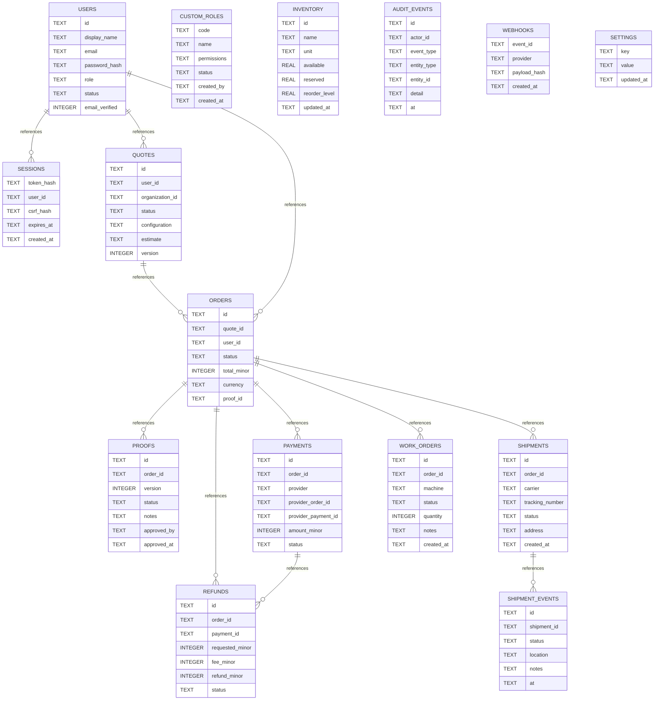

# DesignPro - Development SQLite Schema and ER

> Captured from [`apps/api/db.mjs`](../../apps/api/db.mjs) on `main` (2026-11-09). **SQLite is a local UAT data store**; this is not a production physical database or a PostgreSQL migration.

## UAT ER diagram


## SQLite table/column dictionary
### `users`
| Column | SQLite type |
|---|---|
| `id` | `TEXT` |
| `display_name` | `TEXT` |
| `email` | `TEXT` |
| `password_hash` | `TEXT` |
| `role` | `TEXT` |
| `status` | `TEXT` |
| `email_verified` | `INTEGER` |
| `organization_id` | `TEXT` |
| `created_at` | `TEXT` |

### `custom_roles`
| Column | SQLite type |
|---|---|
| `code` | `TEXT` |
| `name` | `TEXT` |
| `permissions` | `TEXT` |
| `status` | `TEXT` |
| `created_by` | `TEXT` |
| `created_at` | `TEXT` |

### `sessions`
| Column | SQLite type |
|---|---|
| `token_hash` | `TEXT` |
| `user_id` | `TEXT` |
| `csrf_hash` | `TEXT` |
| `expires_at` | `TEXT` |
| `created_at` | `TEXT` |

### `quotes`
| Column | SQLite type |
|---|---|
| `id` | `TEXT` |
| `user_id` | `TEXT` |
| `organization_id` | `TEXT` |
| `status` | `TEXT` |
| `configuration` | `TEXT` |
| `estimate` | `TEXT` |
| `version` | `INTEGER` |
| `firm_total_minor` | `INTEGER` |
| `expires_at` | `TEXT` |
| `created_at` | `TEXT` |
| `updated_at` | `TEXT` |

### `orders`
| Column | SQLite type |
|---|---|
| `id` | `TEXT` |
| `quote_id` | `TEXT` |
| `user_id` | `TEXT` |
| `status` | `TEXT` |
| `total_minor` | `INTEGER` |
| `currency` | `TEXT` |
| `proof_id` | `TEXT` |
| `address` | `TEXT` |
| `created_at` | `TEXT` |
| `updated_at` | `TEXT` |

### `proofs`
| Column | SQLite type |
|---|---|
| `id` | `TEXT` |
| `order_id` | `TEXT` |
| `version` | `INTEGER` |
| `status` | `TEXT` |
| `notes` | `TEXT` |
| `approved_by` | `TEXT` |
| `approved_at` | `TEXT` |
| `created_at` | `TEXT` |

### `payments`
| Column | SQLite type |
|---|---|
| `id` | `TEXT` |
| `order_id` | `TEXT` |
| `provider` | `TEXT` |
| `provider_order_id` | `TEXT` |
| `provider_payment_id` | `TEXT` |
| `amount_minor` | `INTEGER` |
| `status` | `TEXT` |
| `created_at` | `TEXT` |
| `updated_at` | `TEXT` |

### `refunds`
| Column | SQLite type |
|---|---|
| `id` | `TEXT` |
| `order_id` | `TEXT` |
| `payment_id` | `TEXT` |
| `requested_minor` | `INTEGER` |
| `fee_minor` | `INTEGER` |
| `refund_minor` | `INTEGER` |
| `status` | `TEXT` |
| `requested_by` | `TEXT` |
| `approved_by` | `TEXT` |
| `reason` | `TEXT` |
| `provider_refund_id` | `TEXT` |
| `created_at` | `TEXT` |
| `updated_at` | `TEXT` |

### `shipments`
| Column | SQLite type |
|---|---|
| `id` | `TEXT` |
| `order_id` | `TEXT` |
| `carrier` | `TEXT` |
| `tracking_number` | `TEXT` |
| `status` | `TEXT` |
| `address` | `TEXT` |
| `created_at` | `TEXT` |
| `updated_at` | `TEXT` |

### `shipment_events`
| Column | SQLite type |
|---|---|
| `id` | `TEXT` |
| `shipment_id` | `TEXT` |
| `status` | `TEXT` |
| `location` | `TEXT` |
| `notes` | `TEXT` |
| `at` | `TEXT` |

### `work_orders`
| Column | SQLite type |
|---|---|
| `id` | `TEXT` |
| `order_id` | `TEXT` |
| `machine` | `TEXT` |
| `status` | `TEXT` |
| `quantity` | `INTEGER` |
| `notes` | `TEXT` |
| `created_at` | `TEXT` |

### `inventory`
| Column | SQLite type |
|---|---|
| `id` | `TEXT` |
| `name` | `TEXT` |
| `unit` | `TEXT` |
| `available` | `REAL` |
| `reserved` | `REAL` |
| `reorder_level` | `REAL` |
| `updated_at` | `TEXT` |

### `audit_events`
| Column | SQLite type |
|---|---|
| `id` | `TEXT` |
| `actor_id` | `TEXT` |
| `event_type` | `TEXT` |
| `entity_type` | `TEXT` |
| `entity_id` | `TEXT` |
| `detail` | `TEXT` |
| `at` | `TEXT` |

### `webhooks`
| Column | SQLite type |
|---|---|
| `event_id` | `TEXT` |
| `provider` | `TEXT` |
| `payload_hash` | `TEXT` |
| `created_at` | `TEXT` |

### `settings`
| Column | SQLite type |
|---|---|
| `key` | `TEXT` |
| `value` | `TEXT` |
| `updated_at` | `TEXT` |

## Local database procedure
```bash
# From repo root, Node.js >=22; do not use against production
npm run db:migrate
npm run admin:bootstrap
npm test
npm run coverage
```

Never upload a real customer's artwork or perform real financial transactions in this UAT environment. `node:sqlite` experimental APIs and local SQLite on an ephemeral free-hosted server are not a production persistence architecture.

## Production DB design gate
1. Choose durable managed database/storage, implement/review the PostgreSQL adapter and version-controlled incremental migrations.
2. Design schema-level constraints, concurrent proof revisions, quote/order state transitions, inventory reservations and external payment idempotency; test under concurrent load.
3. Handle file assets securely with signed URLs, virus/type scans, object-storage retention and role-limited downloads.
4. Verify webhook signatures, refunds, settlements, tax/invoice snapshots, data encryption and audit before payments enabled.
5. Rehearse backup and restore; validate release gates in [`docs/RELEASE_GATES.md`](../../docs/RELEASE_GATES.md).
6. Only after all above, generate and sign the authoritative physical ER from real deployment.

## Handover
[Architecture/deployment/runbook](README.md) · [guarded migration wrapper](migrate-safe.sh) · [native application/DB source](../../apps/api/db.mjs).

**Limitations:** Basic CREATE TABLE static extraction omits later code-defined migration changes, complex constraints, views and indexes.