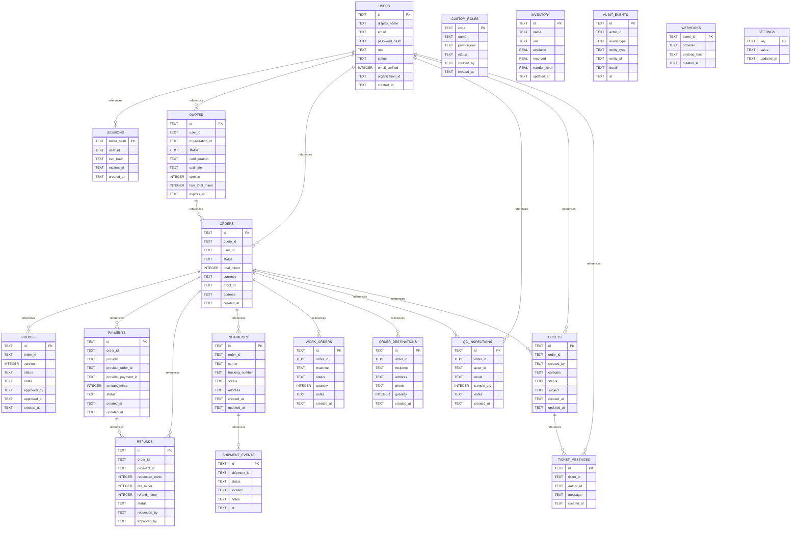

# DesignPro v0.3.0 — complete local SQLite database catalogue

> Generated from current [`apps/api/db.mjs`](../../apps/api/db.mjs) and [`package.json`](../../package.json) on `main` on 10 Nov 2026. **UAT local SQLite only. Do not treat this as a deployed production schema or PostgreSQL migration.**

## Database model
- `node:sqlite` `DatabaseSync`, local file `DATABASE_FILE` (default `./var/designpro.sqlite`).
- `PRAGMA foreign_keys=ON`, WAL and busy timeout are configured in the local open call.
- **19 tables** detected by parsing source `CREATE TABLE` statements, **18 distinct declared parent→child FK relations**. These include newer v0.3 shipping, QC, refund and support data models.
- The application runs `npm run db:migrate` (local UAT only); no durable production PostgreSQL adapter is certified.

## ER diagram


## Table index
| Table | Number of parsed columns | Referenced table hints |
|---|---:|---|
| `users` | 9 | — |
| `custom_roles` | 6 | — |
| `sessions` | 5 | users |
| `quotes` | 11 | users |
| `orders` | 10 | quotes, users |
| `proofs` | 8 | orders |
| `payments` | 9 | orders |
| `refunds` | 13 | orders, payments |
| `shipments` | 8 | orders |
| `shipment_events` | 6 | shipments |
| `work_orders` | 7 | orders |
| `inventory` | 7 | — |
| `audit_events` | 7 | — |
| `webhooks` | 4 | — |
| `settings` | 3 | — |
| `order_destinations` | 7 | orders |
| `qc_inspections` | 7 | orders, users |
| `tickets` | 8 | orders, users |
| `ticket_messages` | 5 | tickets, users |

## Full source-derived column dictionary
### `users`
| Column | Declared SQLite type | PK hint |
|---|---|---|
| `id` | `TEXT` | Yes |
| `display_name` | `TEXT` | — |
| `email` | `TEXT` | — |
| `password_hash` | `TEXT` | — |
| `role` | `TEXT` | — |
| `status` | `TEXT` | — |
| `email_verified` | `INTEGER` | — |
| `organization_id` | `TEXT` | — |
| `created_at` | `TEXT` | — |

### `custom_roles`
| Column | Declared SQLite type | PK hint |
|---|---|---|
| `code` | `TEXT` | Yes |
| `name` | `TEXT` | — |
| `permissions` | `TEXT` | — |
| `status` | `TEXT` | — |
| `created_by` | `TEXT` | — |
| `created_at` | `TEXT` | — |

### `sessions`
| Column | Declared SQLite type | PK hint |
|---|---|---|
| `token_hash` | `TEXT` | Yes |
| `user_id` | `TEXT` | — |
| `csrf_hash` | `TEXT` | — |
| `expires_at` | `TEXT` | — |
| `created_at` | `TEXT` | — |

### `quotes`
| Column | Declared SQLite type | PK hint |
|---|---|---|
| `id` | `TEXT` | Yes |
| `user_id` | `TEXT` | — |
| `organization_id` | `TEXT` | — |
| `status` | `TEXT` | — |
| `configuration` | `TEXT` | — |
| `estimate` | `TEXT` | — |
| `version` | `INTEGER` | — |
| `firm_total_minor` | `INTEGER` | — |
| `expires_at` | `TEXT` | — |
| `created_at` | `TEXT` | — |
| `updated_at` | `TEXT` | — |

### `orders`
| Column | Declared SQLite type | PK hint |
|---|---|---|
| `id` | `TEXT` | Yes |
| `quote_id` | `TEXT` | — |
| `user_id` | `TEXT` | — |
| `status` | `TEXT` | — |
| `total_minor` | `INTEGER` | — |
| `currency` | `TEXT` | — |
| `proof_id` | `TEXT` | — |
| `address` | `TEXT` | — |
| `created_at` | `TEXT` | — |
| `updated_at` | `TEXT` | — |

### `proofs`
| Column | Declared SQLite type | PK hint |
|---|---|---|
| `id` | `TEXT` | Yes |
| `order_id` | `TEXT` | — |
| `version` | `INTEGER` | — |
| `status` | `TEXT` | — |
| `notes` | `TEXT` | — |
| `approved_by` | `TEXT` | — |
| `approved_at` | `TEXT` | — |
| `created_at` | `TEXT` | — |

### `payments`
| Column | Declared SQLite type | PK hint |
|---|---|---|
| `id` | `TEXT` | Yes |
| `order_id` | `TEXT` | — |
| `provider` | `TEXT` | — |
| `provider_order_id` | `TEXT` | — |
| `provider_payment_id` | `TEXT` | — |
| `amount_minor` | `INTEGER` | — |
| `status` | `TEXT` | — |
| `created_at` | `TEXT` | — |
| `updated_at` | `TEXT` | — |

### `refunds`
| Column | Declared SQLite type | PK hint |
|---|---|---|
| `id` | `TEXT` | Yes |
| `order_id` | `TEXT` | — |
| `payment_id` | `TEXT` | — |
| `requested_minor` | `INTEGER` | — |
| `fee_minor` | `INTEGER` | — |
| `refund_minor` | `INTEGER` | — |
| `status` | `TEXT` | — |
| `requested_by` | `TEXT` | — |
| `approved_by` | `TEXT` | — |
| `reason` | `TEXT` | — |
| `provider_refund_id` | `TEXT` | — |
| `created_at` | `TEXT` | — |
| `updated_at` | `TEXT` | — |

### `shipments`
| Column | Declared SQLite type | PK hint |
|---|---|---|
| `id` | `TEXT` | Yes |
| `order_id` | `TEXT` | — |
| `carrier` | `TEXT` | — |
| `tracking_number` | `TEXT` | — |
| `status` | `TEXT` | — |
| `address` | `TEXT` | — |
| `created_at` | `TEXT` | — |
| `updated_at` | `TEXT` | — |

### `shipment_events`
| Column | Declared SQLite type | PK hint |
|---|---|---|
| `id` | `TEXT` | Yes |
| `shipment_id` | `TEXT` | — |
| `status` | `TEXT` | — |
| `location` | `TEXT` | — |
| `notes` | `TEXT` | — |
| `at` | `TEXT` | — |

### `work_orders`
| Column | Declared SQLite type | PK hint |
|---|---|---|
| `id` | `TEXT` | Yes |
| `order_id` | `TEXT` | — |
| `machine` | `TEXT` | — |
| `status` | `TEXT` | — |
| `quantity` | `INTEGER` | — |
| `notes` | `TEXT` | — |
| `created_at` | `TEXT` | — |

### `inventory`
| Column | Declared SQLite type | PK hint |
|---|---|---|
| `id` | `TEXT` | Yes |
| `name` | `TEXT` | — |
| `unit` | `TEXT` | — |
| `available` | `REAL` | — |
| `reserved` | `REAL` | — |
| `reorder_level` | `REAL` | — |
| `updated_at` | `TEXT` | — |

### `audit_events`
| Column | Declared SQLite type | PK hint |
|---|---|---|
| `id` | `TEXT` | Yes |
| `actor_id` | `TEXT` | — |
| `event_type` | `TEXT` | — |
| `entity_type` | `TEXT` | — |
| `entity_id` | `TEXT` | — |
| `detail` | `TEXT` | — |
| `at` | `TEXT` | — |

### `webhooks`
| Column | Declared SQLite type | PK hint |
|---|---|---|
| `event_id` | `TEXT` | Yes |
| `provider` | `TEXT` | — |
| `payload_hash` | `TEXT` | — |
| `created_at` | `TEXT` | — |

### `settings`
| Column | Declared SQLite type | PK hint |
|---|---|---|
| `key` | `TEXT` | Yes |
| `value` | `TEXT` | — |
| `updated_at` | `TEXT` | — |

### `order_destinations`
| Column | Declared SQLite type | PK hint |
|---|---|---|
| `id` | `TEXT` | Yes |
| `order_id` | `TEXT` | — |
| `recipient` | `TEXT` | — |
| `address` | `TEXT` | — |
| `phone` | `TEXT` | — |
| `quantity` | `INTEGER` | — |
| `created_at` | `TEXT` | — |

### `qc_inspections`
| Column | Declared SQLite type | PK hint |
|---|---|---|
| `id` | `TEXT` | Yes |
| `order_id` | `TEXT` | — |
| `actor_id` | `TEXT` | — |
| `result` | `TEXT` | — |
| `sample_qty` | `INTEGER` | — |
| `notes` | `TEXT` | — |
| `created_at` | `TEXT` | — |

### `tickets`
| Column | Declared SQLite type | PK hint |
|---|---|---|
| `id` | `TEXT` | Yes |
| `order_id` | `TEXT` | — |
| `created_by` | `TEXT` | — |
| `category` | `TEXT` | — |
| `status` | `TEXT` | — |
| `subject` | `TEXT` | — |
| `created_at` | `TEXT` | — |
| `updated_at` | `TEXT` | — |

### `ticket_messages`
| Column | Declared SQLite type | PK hint |
|---|---|---|
| `id` | `TEXT` | Yes |
| `ticket_id` | `TEXT` | — |
| `author_id` | `TEXT` | — |
| `message` | `TEXT` | — |
| `created_at` | `TEXT` | — |

## Local reproducibility and maintenance
```bash
# Node.js 22 or newer, local synthetic data only
npm run db:migrate
npm run admin:bootstrap
npm test
npm run coverage
```

**Use data migrations safely:** file-backed SQLite should be backed up using a transaction-safe SQLite backup mechanism, not merely copied while WAL writes are active. Test restoration and check FK integrity and operational workflows. Never ship local experimental SQLite on ephemeral hosting as a business production datastore.

## Production migration design (still an engineering task)
1. Choose a durable managed PostgreSQL service and create versioned migrations (baseline, alterations and repeatable reconciliation) under source control. Do **not** run SQLite DDL verbatim on PostgreSQL.
2. Implement transactional quote/order, proof versioning, work order, inventory, multi-destination shipments, QC, disputes, refunds and support models; enforce constraints and race/idempotency tests.
3. Add artwork uploads to audited private object storage with scanning and signed URLs, no sensitive artwork in demo/local DB or client logs.
4. Configure webhook verification and provider reconciliation; keep `PAYMENTS_ENABLED=false` until legal/finance/security review.
5. Reconcile GST/tax rates, invoice/credit-note snapshots, carrier status and actual manufacturing costing.
6. Perform test restore, functional and negative UAT, penetration and performance/accessibility checks; only then generate certified physical ER from the deployed DB.
7. Follow [release stop conditions](../../docs/RELEASE_GATES.md) and [code-based API/operations map](REVERSE_ENGINEERING.md).

**Static parser caveats:** constraints added later, complex column definitions and partial data may not appear; this is a source dictionary for the local `db.mjs` program, not an executed schema export.
